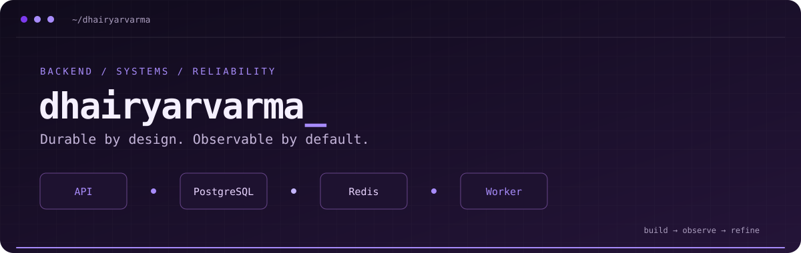

<div align="center">



<br />


[](https://github.com/dhairyarvarma)
[](https://github.com/dhairyarvarma/fault-tolerant-webhook-dispatcher-public)

</div>

## `~/` whoami

```console
dhairyarvarma@github:~$ cat focus.txt
> Backend engineering. Durable data. Explicit failure handling.
> Currently building a fault-tolerant webhook delivery engine in Go.
> Following the event from the first request to the final delivery.
```

I build backend systems with a focus on what happens when things go wrong: a worker crashes, a receiver slows down, or a queue delivers the same message twice.

My current work brings together transactional outboxes, retries, circuit breakers, and observability in one webhook delivery backend.

## `~/` selected work

<table>
<tr>
<td width="50%" valign="top">

### ↗ Webhook Delivery Engine

A durable, asynchronous webhook backend. PostgreSQL holds the durable state; Redis Streams carries work to the workers.

Retries with backoff and jitter, per-target circuit breakers, dead-letter replay, and crash recovery. At-least-once delivery with idempotency protection.

`Go` `PostgreSQL` `Redis` `Docker`

[Explore the repository →](https://github.com/dhairyarvarma/fault-tolerant-webhook-dispatcher-public)

</td>
<td width="50%" valign="top">

### ⌁ Behind the Delivery

A closer look at the same system: the crash boundaries, durable state transitions, and recovery decisions behind a delivery attempt.

Start with the five-minute showcase, then follow the crash-recovery case study through the failure path.

`System design` `Recovery` `Observability`

[Read the showcase →](https://github.com/dhairyarvarma/fault-tolerant-webhook-dispatcher-public/blob/main/docs/showcase.md) · [Crash case study →](https://github.com/dhairyarvarma/fault-tolerant-webhook-dispatcher-public/blob/main/docs/case-study-delivery-crash.md)

</td>
</tr>
</table>

## `~/` tools in this build

<p align="center">

</p>

## `~/` contribution trail

<picture>
  <source media="(prefers-color-scheme: dark)" srcset="https://raw.githubusercontent.com/dhairyarvarma/dhairyarvarma/output/github-snake-dark.svg" />
  <source media="(prefers-color-scheme: light)" srcset="https://raw.githubusercontent.com/dhairyarvarma/dhairyarvarma/output/github-snake.svg" />
  
</picture>

---

<p align="center"><sub>Make the failure path as deliberate as the happy path.</sub></p>
