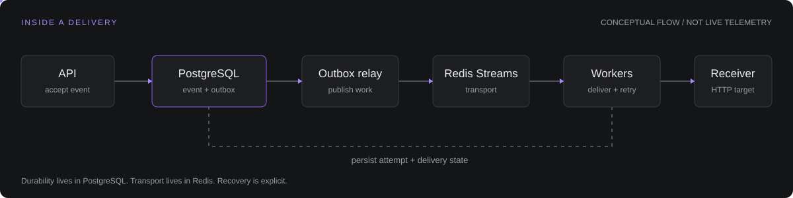

  

I’m **dhairyarvarma**, a **Full Stack Developer** who enjoys turning an idea into a working product and making sure the system behind it holds up. I’m especially interested in how application code, data, and asynchronous work fit together.

On my workbench: a webhook delivery platform built with **Go, PostgreSQL, Redis, and Docker**. I follow each request from API to database to receiver, including retries, restarts, and the less predictable parts.

  
  
  

 

### Featured build

#### [Fault-Tolerant Webhook Delivery Engine ↗](https://github.com/dhairyarvarma/fault-tolerant-webhook-dispatcher-public)

A webhook delivery platform built around a simple promise: once an event is accepted, it has a durable path to its destination, even when parts of the system fail.

PostgreSQL owns the durable state. A transactional outbox feeds Redis Streams. Workers handle delivery with bounded retries, per-target circuit breakers, and dead-letter replay.

> At-least-once delivery, with idempotency protection. The interesting part is what happens between attempts.

[Take the five-minute tour](https://github.com/dhairyarvarma/fault-tolerant-webhook-dispatcher-public/blob/main/docs/showcase.md) &nbsp; / &nbsp; [Follow a worker crash](https://github.com/dhairyarvarma/fault-tolerant-webhook-dispatcher-public/blob/main/docs/case-study-delivery-crash.md) &nbsp; / &nbsp; [Read the code](https://github.com/dhairyarvarma/fault-tolerant-webhook-dispatcher-public)

 

### Design notes

<table>
<tr>
<td width="50%" valign="top">

#### 01 / When a worker disappears

What happens if a receiver accepts a request but the worker crashes before recording success? Follow the boundary between a durable event and an external side effect.

[Read the recovery case study ↗](https://github.com/dhairyarvarma/fault-tolerant-webhook-dispatcher-public/blob/main/docs/case-study-delivery-crash.md)

</td>
<td width="50%" valign="top">

#### 02 / The delivery contract

Queues, retries, and idempotency have different jobs. The system’s guarantees start with being explicit about what each one can promise.

[Explore the delivery semantics ↗](https://github.com/dhairyarvarma/fault-tolerant-webhook-dispatcher-public/blob/main/QUEUE_AND_DELIVERY_SEMANTICS.md)

</td>
</tr>
</table>

### Tools I use

  

**Application** &nbsp; Go &nbsp; · &nbsp; **Data & queues** &nbsp; PostgreSQL · Redis &nbsp; · &nbsp; **Delivery & visibility** &nbsp; Docker · Prometheus · Grafana

Shown from the project I’m building.

 

### How I approach a build

<table><tr><td><b>01 · Understand the flow</b> Map a request through the app and its dependencies.</td><td><b>02 · Plan for failure</b> Decide how retries and recovery should work.</td><td><b>03 · Make it observable</b> Leave enough evidence to explain what happened.</td></tr></table>

---

### GitHub activity

Contribution history · updated daily

<picture>
  <source media="(prefers-color-scheme: dark)" srcset="https://raw.githubusercontent.com/dhairyarvarma/dhairyarvarma/output/github-snake-dark.svg" />
  <source media="(prefers-color-scheme: light)" srcset="https://raw.githubusercontent.com/dhairyarvarma/dhairyarvarma/output/github-snake.svg" />
  
</picture>

Curious by default. Building one piece at a time.

